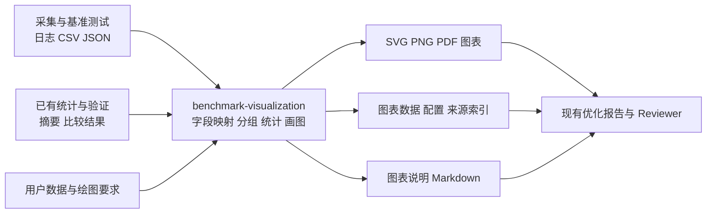

# P1 通用性能图表 SKILL 实施计划

## 1. 目标与定位

新增 `benchmark-visualization` SKILL，以**通用性能图表绘制**为核心能力：读取用户或 KPBot 上游产生的数据，根据用户选择的性能指标、统计量、维度和图表形式，输出可复现、可追溯的图表及其底层数据。

本次修订将原计划的 `benchmark-result-report` 更名为 `benchmark-visualization`。首版从通用数据模型和常见图表出发，同时覆盖时间、吞吐、资源和微架构指标；Faiss、TF 和 app-tuner 是接入来源示例，不构成能力边界。文字报告是图表附件，不能代替图表交付。

设计目标是覆盖绝大多数常见性能实验的表达需求，而不是宣称任意日志、任意科学统计或任意图形都可直接处理。对暂未支持的格式提供明确字段映射，对缺失数据不推测补造。

本文件为实施计划，尚未实现新 SKILL。所有后续新增、修改均置于 `KPBot-zl`，遵循原项目相对目录结构，不修改 `KPBot-master`。

## 2. 当前 KPBot 的不足与新增价值

| 当前能力 | 已有内容 | 仍需要补齐的图表能力 |
| --- | --- | --- |
| `vector-experiment-methodology` / P0 | 中位数、样本数、加速比、min/max、MAD | 用户选择指标与统计量后，绘制重复实验分布和多维比较 |
| `verify-optimization` | 输入规模矩阵、原始结果与验收证据 | 可配置的规模曲线、多个版本/配置比较 |
| `tf-benchmark` / `tf-result-verify` | 吞吐、P99、CPU、负载扫描与归因 | 可选择横纵轴、系列、聚合方式的通用图表 |
| app-tuner 的采集和结果汇总 | 系统、应用和硬件数据及收益摘要 | CPU、内存、网络、微架构等自定义指标的统一可视化 |
| app-tuner 的 `generate_report.py` | 整体优化过程 Markdown 报告 | 可稳定引用的图表附件及图表数据 |
| `sandbox-timeline-profile` | 特定沙箱场景时序图、Excel 和 PNG | 保留专项能力；通用技能负责标准化后的阶段数据展示 |

主要不足：

1. 图表能力与个别场景绑定，缺少接受用户自定义列、指标和图形的统一入口。
2. 原始观测、每轮汇总、跨轮汇总缺少一致的表达方式，容易把重复实验和请求级样本混为一谈。
3. 缺少从“我要看什么”到轴、分组、聚合、图形选择的完整流程。
4. 图表、统计摘要和原始来源之间缺少统一追溯关系，难以核查人工整理的图中数字。
5. 缺少通用图表产物接口，现有优化报告和审核流程不能方便地复用。

本技能的价值是让已有性能证据得到正确、灵活且可复现的图形表达，同时减少重复编写临时绘图脚本的成本。

## 3. 上下游与调用位置

### 3.1 数据流



**基本调用位置：有可用测量结果之后，需要检查、比较或交付图表时。** 不必等待全部优化结束；一次实验完成后、阶段性分析时、最终报告整理时均可使用。

### 3.2 具体上游

| 上游 | 在谁之后使用 | 提供什么 | 本技能做什么 |
| --- | --- | --- | --- |
| Faiss/VSAG 基线与比较流程 | 基准结果或比较摘要产生后 | 多轮结果、配置、数据集身份 | 绘制用户指定指标的样本、汇总和比较图 |
| `verify-optimization` | 输入规模矩阵/验证数据产生后 | size、版本、测量值、正确性证据 | 绘制规模曲线和版本对比 |
| `tf-benchmark` | 压测 CSV 产生后 | 负载、吞吐、延迟、CPU 等 | 绘制负载曲线、相关关系和多指标面板 |
| app-tuner / kptools | 采集完成并解析成数值表后 | 资源与微架构时间序列、配置、轮次 | 绘制时间线、重复实验图、参数热力图 |
| P0 / 其他统计脚本 | 已有统计值产生后 | min/max/median/MAD 等 | 按原粒度展示已有统计，不伪造原始分布 |
| 用户 | 用户提交结构化数据或字段映射后 | 自定义 CSV/JSON/TSV、图表需求 | 独立绘图，无需先运行 KPBot 全流程 |

原始 perf 或工具专有日志若无法直接解析，应先由相应采集/解析技能转为表格；本技能不承诺自动解析所有工具的文本格式。

### 3.3 下游及用户交付物

执行后，用户获得：

- 可直接查看、分享或嵌入报告的 SVG/PNG；按需提供 PDF。
- 每幅图实际使用的数据 CSV，便于核对和二次作图。
- 解析后的绘图配置 JSON，可修改指标、图型、分组后重新生成。
- 来源与变换记录，说明图中数据来自哪里、如何过滤、如何聚合。
- 简短 Markdown 图表说明：比较对象、指标单位、样本粒度、图例含义及已知限制。

下游可由 `generate_report.py` 的报告整理环节引用图表，或由 `verify-optimization`、Faiss Reviewer、用户人工审核消费。报告生成成功不等于优化已通过验收，不自动接受或回退优化。

## 4. 用户如何使用

### 4.1 自然语言示例

- “按编译器版本比较运行时间，用散点显示每次独立实验，再叠加中位数。”
- “横轴线程数，纵轴吞吐量，按 CPU 型号分线，均值上下画标准差。”
- “这份表已经有每轮 min/max/median，请分别画出来，不再重新聚合。”
- “按代码版本比较 IPC、分支预测失败率和 LLC miss，分成三个子图。”
- “用折线图画 CPU 利用率随时间变化，按实验编号分线，保留预热阶段标记。”
- “给不同 batch size 和并发组合画 P99 热力图，缺失组合留空。”
- “将运行时间与内存占用画成散点图，颜色表示算法，点大小表示输入规模。”
- “叠加五次独立实验的吞吐曲线，再给出各负载点的中位数与 min/max 范围。”

### 4.2 执行步骤

1. 读取输入格式、列名、类型、单位、轮次和已有统计信息。
2. 将用户要求映射成指标、维度、统计层级、图型和样式配置。
3. 对缺少的关键语义集中询问，例如单位、实验轮次列、百分数表示方式、min/max 是现成值还是需要计算。
4. 若用户未指定图型，根据分析目的推荐合理默认，并在产物中记录选择；已明确的要求不重复确认。
5. 校验数据、分组和统计操作是否支持所需图形。
6. 生成图表、图表数据和说明，检查标签、数值和来源一致性。
7. 用户后续要求“换折线、只看某指标、按另一个维度分组”时，复用数据与配置重新渲染。

默认不启动额外压测，不修改输入数据。无法从已有数据生成的图形，解释缺少什么并交付可生成的部分；不得将部分交付称为全部完成。

## 5. 自定义指标与维度模型

### 5.1 指标不写死

每个指标由用户或上游声明以下属性：

| 属性 | 含义 |
| --- | --- |
| name / label | 原始字段名与展示名称 |
| unit | s、ms、ns、QPS、GB/s、cycles、instructions、比例等；也允许自定义单位 |
| direction | higher / lower / neutral / unknown，仅比较收益时需要 |
| value_kind | 原始数值、计数、比率、累计计数器、现成统计值 |
| sample_level | 请求级、时间采样点、每次独立实验、每轮汇总、跨轮汇总 |
| source_statistic | 输入是否已经是 mean、median、min、max、p99 等 |
| aggregation | 本次是否聚合，以及在什么层级聚合 |

支持时间/延迟、吞吐/带宽、资源利用率、内存占用、微架构计数及比率、质量/错误指标和用户自定义数值。

方向不用于限制普通绘图：IPC 可以按用户要求比较，CPU 利用率可以只看走势，不强行判定越低越好。用户提供的零值和负值是否有效取决于指标语义；通用绘图不能继承 P0 对正值性能比值的全局限制。

### 5.2 维度可任意组合

常见维度包括版本、配置、硬件、编译器、数据集、输入规模、线程、并发、batch、实验编号和时间戳。它们可以绑定到 x/y、颜色、线型、点型、点大小、分组或分面。

数值横轴按数值排序，类别轴保留指定顺序。多个指标量纲不同时优先使用分面；用户要求双轴时显式标明各轴、单位及系列归属，不能暗示相同数值尺度。

## 6. 输入与配置契约

### 6.1 首版输入

- CSV/TSV：支持长表和宽表，通过配置指定字段映射。
- JSON：支持记录数组及明确声明的适配器格式。
- P0 向量比较原始输入/输出：作为内置适配器之一。
- 用户粘贴的小型表格：先保存结构化文件，保留来源说明。

XLSX、其他工具专有日志作为后续适配扩展，不作为首版必需依赖。不存在语义声明的列不凭名称猜测单位或实验层级。

### 6.2 统一内部数据

采用长表表示：每条记录至少包含指标名、值、单位、维度和来源定位；必要时增加 experiment_id、repeat_id、sample_id、timestamp、statistic、status。

例：多个独立运行中，每个运行都含时间序列，必须同时保留 run 与 timestamp；不能将所有时间点直接视为独立实验次数。

没有轮次 ID 的旧数据可生成来源行标识，但该标识不能证明实验独立性。聚合结果缺少样本数时显示 unknown，而不是假定为 1。

### 6.3 绘图配置示例

下例为设计中的配置形态，字段和数据均为示例：

```json
{
  "schema_version": "benchmark-visualization.v1",
  "input": {"path": "results.csv", "format": "csv"},
  "mapping": {
    "experiment_id": "run_id",
    "dimensions": ["version", "threads"],
    "metrics": [
      {"column": "elapsed_ms", "name": "elapsed", "unit": "ms", "direction": "lower", "sample_level": "independent_run"},
      {"column": "ipc", "name": "ipc", "unit": "instructions/cycle", "direction": "neutral", "sample_level": "independent_run"}
    ]
  },
  "charts": [
    {
      "id": "elapsed_by_threads",
      "type": "line",
      "metric": "elapsed",
      "x": "threads",
      "series": "version",
      "aggregate": {"method": "median", "over": "experiment_id"},
      "spread": "minmax",
      "show_samples": true
    },
    {
      "id": "ipc_repeats",
      "type": "scatter",
      "metric": "ipc",
      "x": "version",
      "color": "version",
      "aggregate": null,
      "show_samples": true
    }
  ],
  "output": {"formats": ["svg", "png"], "directory": "charts-output"}
}
```

配置支持过滤、轴范围、尺度、排序、标题、图例、分面和样式；过滤规则与丢弃数量必须进入记录。禁止用任意 Python 表达式或 eval 执行用户配置。

## 7. 多次独立实验与统计层级

### 7.1 三类数据必须分清

| 输入 | 允许的展示 | 不允许推断 |
| --- | --- | --- |
| 每次独立实验一个结果 | 每轮散点、箱线图、跨轮均值/中位数与离散度 | 单个汇总值代表请求级分布 |
| 每次实验包含请求样本或时间序列 | 每轮分布/曲线、每轮先聚合后跨轮比较 | 把相关时间点当作更多独立运行 |
| 每轮已有 min/max/median/p99 | 直接展示各统计量、各轮统计量的分布 | 从现成统计量还原原始样本或总体分位数 |

例如五次实验各有 1000 个请求：可画五个“每轮中位数”点，或者明确标为请求级的分布。不能默认将 5000 个请求当作 5000 次独立实验。

### 7.2 用户选择统计量

支持 count、min、max、mean、median、指定分位数、标准差、MAD；支持“不聚合”。分位数算法和标准差自由度应在实现中固定、记录，并允许受控配置。

如果输入列已经是 `median_latency`，再次取中位数时必须标为“各轮中位数的中位数”。如果用户指定“画最小值”，先确定是绘制现成 min 列，还是在明确分组内计算 min。

范围带支持 min/max、IQR、mean±SD。MAD 可作为描述性范围展示，但须明确含义；不能把这些范围叫置信区间。置信区间作为扩展功能，只有明确独立/配对单位、估计目标和计算方法后才提供，首版不默认生成。

单样本可画散点和数值；样本标准差在不足两条时为不可用。小样本箱线/小提琴不能营造充分估计分布的假象，优先显示原始点并注明 n。

### 7.3 配对、顺序与失败轮

- 配对比较必须有真实 pair_id 或明确匹配规则，不能按数组位置自动配对。
- 实验顺序只有在上游提供时才能用于漂移展示；无法凭行号声称真实时间顺序。
- 失败、超时、预热和被排除数据分别标记，不默认为零，也不静默删除。
- 单位不同的值先经明确换算再比较，保留原单位及换算因子。
- 同一组内存在多个尚未分组的维度时，提示歧义，不能默认混合硬件或配置。

## 8. 图表能力矩阵

| 图表 | 典型问题 | 输入要求及注意事项 | 阶段 |
| --- | --- | --- | --- |
| 散点/分组散点 | 每轮波动、两个指标关系 | 原始观测或明确的每轮统计；抖动仅改变显示位置，固定种子 | 首版 |
| 折线/多系列折线 | 时间、规模、线程、并发变化 | 有序横轴；重复 x 必须选择逐轮线或聚合，缺失点断线 | 首版 |
| 点估计+误差棒/范围带 | 中心值与波动范围 | 明确统计量和上下界含义，不伪装为置信区间 | 首版 |
| 分组柱状图/水平柱状图 | 多版本、类别、多个统计量 | 标签和单位明确，通常从零起轴；过多类别改用点图 | 首版 |
| 箱线图+原始点 | 重复实验分布 | 有原始样本，显示 n；离群点不意味着应删除 | 首版 |
| 直方图/ECDF | 请求延迟、运行时间分布 | 明确样本层级和权重；对比直方图使用一致分箱 | 首版 |
| 热力图 | 两个参数维度的性能矩阵 | 每单元聚合规则明确；缺失单元留空，零值正常显示 | 首版 |
| 分面/多子图 | 多指标、不同硬件、不同单位 | 明确轴是否共享，保留统一系列配色 | 首版 |
| 堆叠柱状/面积图 | 阶段构成、资源组成 | 组成可加且不重叠；禁止把重叠阶段或不同分位数相加 | 扩展 |
| 小提琴图 | 样本较多的分布形态 | 核密度估计需要足够数据，记录带宽；小样本回退散点 | 扩展 |
| 通用时间区间/Gantt | 阶段耗时与并行关系 | 需要真实开始/结束和父子关系，不能用均值拼造真实时序 | 扩展 |
| 气泡/双轴/归一化多指标 | 三维关系、量纲不同的趋势 | 显式配置和图注，不自动混用尺度 | 扩展 |

收益图只是点图/柱状图的一种配置，不是技能唯一目标。饼图、雷达图和 3D 图不列为默认选项；有明确数据含义和用户需求时再评估，避免维护低价值图型。

## 9. 微架构与派生指标细节

支持 instructions、cycles、IPC、CPI、cache miss、branch miss、带宽等用户提供的列，但不能仅凭字段名确定计量口径。

- 比率需要明确分子、分母、单位和采样窗口；比率平均与总分子/总分母是不同统计目标，由用户选择。
- 每轮 IPC 的分布应使用每轮数值；整体 IPC 若由计数推导，应按对齐后的总 instructions / 总 cycles 计算，不能混称。
- 累计计数器转换为速率需要时间差及重置/溢出规则，首版优先接收上游已计算结果。
- PMU multiplexing/scaling、采样周期和 CPU 归一化方式作为元数据保留；缺少信息时不能声称跨机数值直接可比。
- 派生指标使用白名单运算，例如差值、比值、百分比、按已知时长归一化，记录计算公式；除零、无效分母和无法对齐的数据显式报错或标为不可用。
- 绝对差值允许负数；对数轴不接受零或负数，必要时改用线性轴或显式配置 symlog。

## 10. 比较与解释的边界

普通绘图不要求所有环境相同：用户可以研究不同机器和配置的差异，只需准确标注。只有生成“同条件优化收益”时才检查冻结条件和刻意变化因素。

比较状态为 comparable、unknown、not_comparable。未知或不匹配时仍可按用户要求画观测值，但不得附带未经验证的优化归因或全局收益声明。

正确性 passed/failed/unknown 独立展示。性能图可以用于诊断失败实现，但不能掩盖正确性失败。

同一指标的 speedup、原值变化比例和绝对差值分别命名。几何平均只用于适合比值汇总的正值、同类指标和明确工作负载矩阵；不将 IPC、延迟和内存占用混合成没有定义的总分。

吞吐—延迟曲线属于通用双指标图。只有用户提供 SLO、失败预算等约束时，才标出“满足约束的最高已测点”，不把插值或外推值叫实测容量。

## 11. 可视化质量、输出与可复现性

### 11.1 渲染原则

以 Matplotlib 无界面渲染为基础，首版导出 SVG/PNG，按需 PDF；离线运行，不依赖浏览器或 CDN。统计、适配和渲染分层。

统一要求：轴名与单位完整、图例可辨识、系列配色跨图稳定、退化不隐藏、颜色之外提供形状/线型区别；坐标截断、对数尺度、归一化、平滑及下采样必须显式记录。

默认不平滑、不删除离群值。大数据量可以为显示进行可追溯下采样，但统计使用全部有效数据；记录方法、种子、显示点数与总点数。若无法保证方法适合当前图型，明确要求用户缩小范围，不静默抽样。

检测字体可用性，中文缺字时选择可用字体或明确反馈。图表需视觉检查，不能只确认文件存在。

### 11.2 产物目录

```text
visualization-output/
├── index.md
├── chart-spec.resolved.json
├── summary.json
├── provenance.json
├── data/
│   ├── chart-01.csv
│   └── chart-02.csv
└── figures/
    ├── chart-01.svg
    ├── chart-01.png
    ├── chart-02.svg
    └── chart-02.png
```

每幅图用稳定 ID 关联数据、配置和来源。provenance 记录文件哈希、行/JSON 路径、过滤、转换、统计、工具版本和依赖版本。原始文件不修改；按需打包数据时尊重路径和隐私要求，不自动向外部服务上传。

缺少绘图库时可以输出配置和数据，但该状态是 incomplete，不能算图表任务成功。输出目录冲突默认报错或创建新目录；只有显式指定才覆盖本工具产物，禁止递归清理用户目录。

## 12. 技能组织与代码设计

建议位于 `Plugins/code-optimizer/skills/benchmark-visualization/`。这是现有插件中的通用工具型技能，初期依托已有代码优化工具链分发，也可独立接受 app-tuner 或用户数据。无需创建新插件。

```text
benchmark-visualization/
├── SKILL.md
├── references/
│   ├── data-contract.md
│   ├── chart-selection.md
│   └── statistics-rules.md
├── scripts/
│   ├── visualize.py
│   ├── adapters.py
│   ├── statistics.py
│   └── render.py
└── assets/examples/
    ├── repeated-runs.csv
    ├── summary-statistics.csv
    ├── time-series.csv
    └── chart-spec.json
```

`SKILL.md` 沿用原版“输入、执行步骤、输出、约束、参考资料”的简洁风格。描述以自定义性能图表为中心，详细契约放 references，不在入口堆积工具百科。

建议命令：

```bash
python scripts/visualize.py --input results.csv --spec chart-spec.json --output-dir visualization-output
```

输入适配层负责格式映射；统计层负责显式的分组聚合；渲染层仅消费已准备好的数据。禁止让每一种图型单独重复计算统计量。

P0 作为向量 A/B 比较适配器复用，保留其字段和口径。通用绘图没有 P0 时也能处理标准表格；不强制所有自定义指标经过向量检索比较脚本。若未来要统一公共统计函数，应另行验证兼容性，避免为了绘图先重构全部现有技能。

配置严格验证，禁止 eval；文件名使用内部 ID，标签转义，不将任意输入作为路径或 shell 命令。尽可能记录错误发生在哪幅图、哪条记录、哪个字段。

## 13. 实施阶段与范围

| 阶段 | 内容 | 完成条件 |
| --- | --- | --- |
| A：数据与配置契约 | 自定义指标、长宽表、维度、轮次、已有统计、图型声明 | 用时间、吞吐、微架构三类数据走通配置，不绑定单个指标 |
| B：统计与追溯 | 分组、选择统计量、重复实验层级、缺失/失败处理 | 数值与来源一致，已有统计不被误当原始数据 |
| C：通用基础图表 | 散点、折线、点估计/范围、柱状、箱线、直方图/ECDF、热力图、分面 | 覆盖首版图表矩阵，所有图可导出且经过视觉检查 |
| D：接入与交付 | P0 适配、TF CSV 字段映射示例、app-tuner 标准表格示例、安装测试 | 用户可独立使用，也能在已有工作流数据产生后调用 |
| E：增强表达 | 堆叠、小提琴、时间区间、显式双轴及更多适配器 | 按实际需求逐项验收，不影响核心图表行为 |

A—D 为首版目标。执行时先完成散点/折线及重复实验端到端链路，再逐项补齐同一通用模型上的图型；不能将“完成一个 Faiss 指标模板”当作首版验收。

暂不实现常驻监控、历史数据平台、任意日志解析和默认显著性检验。交互式 HTML 如有后续需求可作为输出后端扩展，首版以便于 PR 和报告分享的静态图为主。

## 14. 验证与验收标准

### 14.1 代表性用例

1. 运行时间：三个版本、每版多次实验，散点+中位数、箱线图。
2. 吞吐：线程数扫描、每档重复实验，多系列折线+min/max 范围。
3. 微架构：IPC、LLC miss rate、cycles，分别使用分面、自定义单位与中性方向。
4. 已有统计：每轮 min/max/median 列直接绘图，验证没有重新伪造分布。
5. 时间序列：多轮 CPU 采样，按 run 分线，缺失时间点断线。
6. 多参数：batch×concurrency 的 P99 热力图，缺失格与真实零值可区分。
7. 请求级分布：直方图和 ECDF，明确每轮/请求级层次。
8. 配对实验：有 pair_id 时按指定关系展示；无 ID 时不能自动配对。

### 14.2 边界测试

覆盖单样本、两样本、全相同值、极端值、负差值、零计数、NaN/Infinity、缺失单位、不同单位、缺失轮次、重复 ID、乱序时间、不同分组大小、除零、无效对数轴、摘要与原始数据不一致，以及超时/失败/预热记录。

测试图表实际使用的数据、分组和图元数量，避免仅测试实现细节。检查图文统计一致、没有虚假误差棒、没有静默排除退化结果。不同字体和版本下不要求图片逐字节一致。

### 14.3 平台与集成验收

验证 Claude Code/OpenCode 安装后的技能发现、脚本路径、依赖提示和离线渲染。安装验证在独立临时完整项目副本进行，不覆盖 `KPBot-master`。

使用合成样例验证确定性逻辑，并使用可获得的真实结果验证字段适配。没有真实输入或目标机验证时记录 pending，不能将合成图当作真实性能证据。

**最终验收重点：用户能自行决定画哪个指标、哪个统计量、按什么维度和图型展示；多次独立实验及其波动能被准确呈现；每幅图能追溯并复现。**

## 15. 项目接入和审核材料

新增技能后同步更新实际涉及的技能数量、使用说明和安装测试。已有流程只增加图表阶段调用或附件引用，不改变验证器的接受判据。

审核材料应包含：问题说明、技能边界、三类不同性能指标的示例图、多次独立实验示例、数据与配置、自动测试结果、视觉检查结果及安装验证结果。

主要依据为本地项目中的 `docs/STANDARDS.md`、`install.sh`、向量实验契约、P0 改动、`verify-optimization`、`tf-benchmark`、app-tuner 报告脚本和专项可视化技能。维护者是否合入取决于实际实现及审核，本计划不保证合入。
