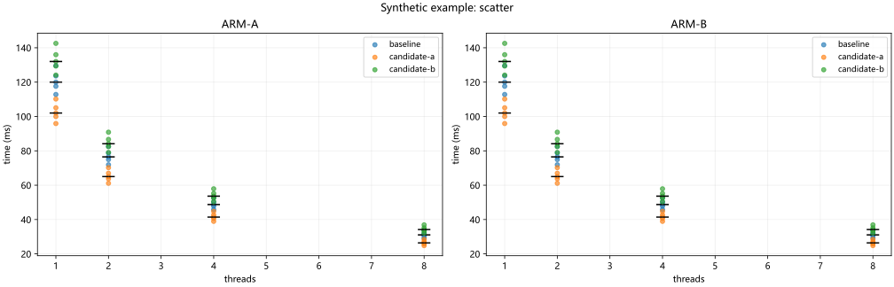
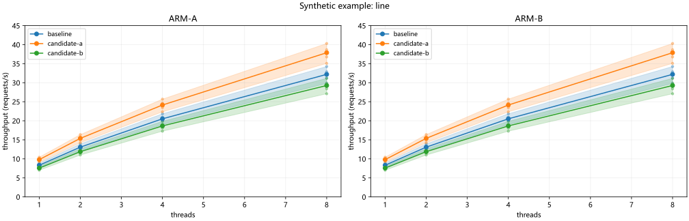
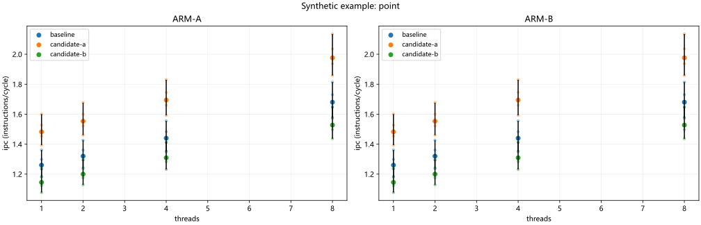
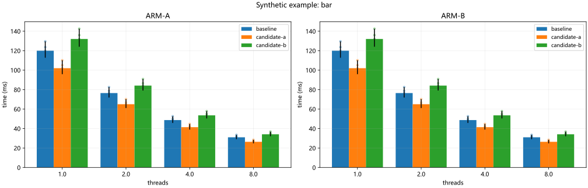
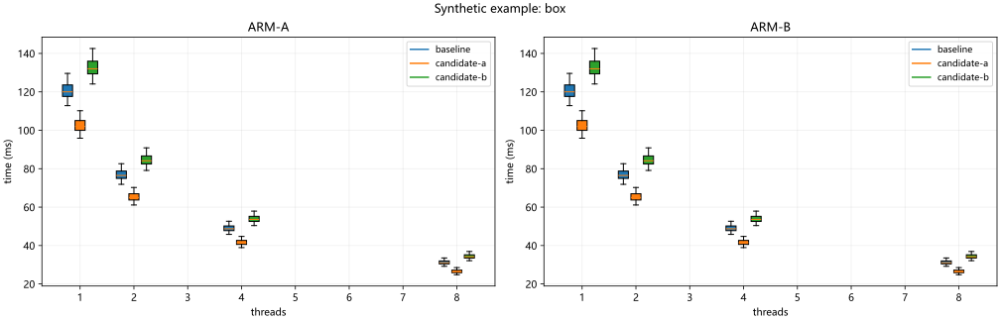
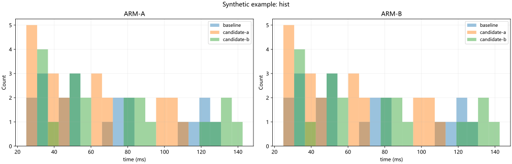
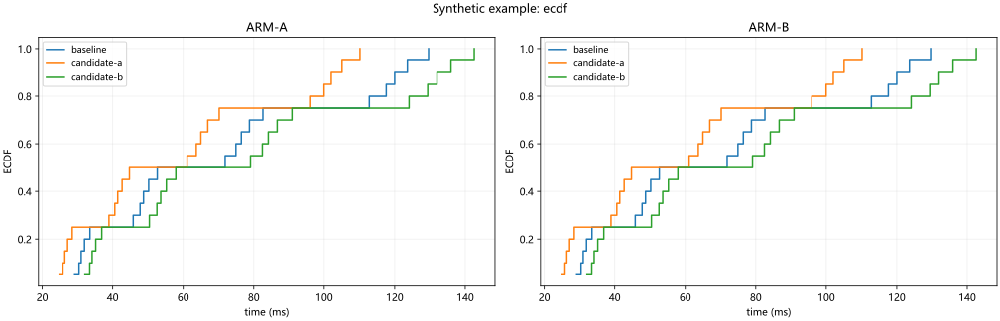
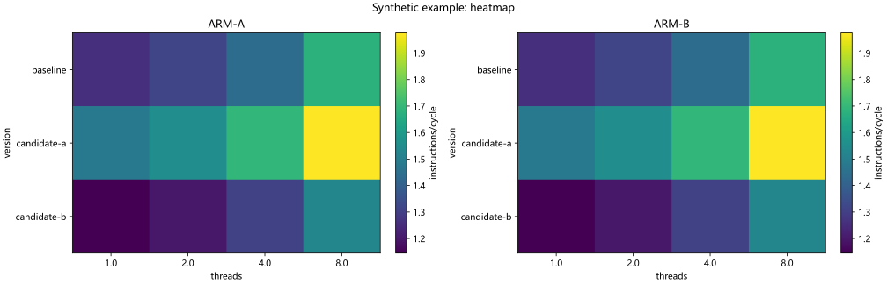

# Performance charts

Charts describe supplied measurements; they do not certify optimization acceptance.

## scatter

Metric: time; sample level: independent_run; aggregation: median; range: None. Selected 120 / 120 records.

## line

Metric: throughput; sample level: independent_run; aggregation: median; range: minmax. Selected 120 / 120 records.

## point

Metric: ipc; sample level: independent_run; aggregation: median; range: minmax. Selected 120 / 120 records.

## bar

Metric: time; sample level: independent_run; aggregation: median; range: minmax. Selected 120 / 120 records.

## box

Metric: time; sample level: independent_run; aggregation: None; range: None. Selected 120 / 120 records.

## hist

Metric: time; sample level: independent_run; aggregation: None; range: None. Selected 120 / 120 records.

## ecdf

Metric: time; sample level: independent_run; aggregation: None; range: None. Selected 120 / 120 records.

## heatmap

Metric: ipc; sample level: independent_run; aggregation: median; range: None. Selected 120 / 120 records.

