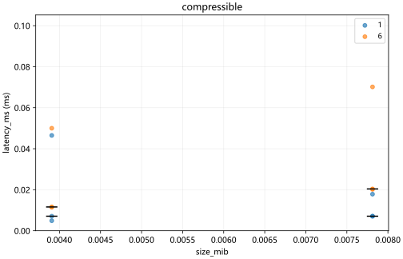

# Performance charts

Charts describe supplied measurements; they do not certify optimization acceptance.

## scatter

Metric: latency_ms; sample level: summary; aggregation: median; range: None. Selected 12 / 12 records.

