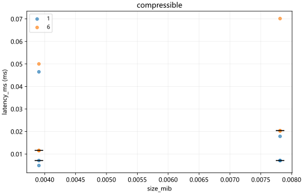
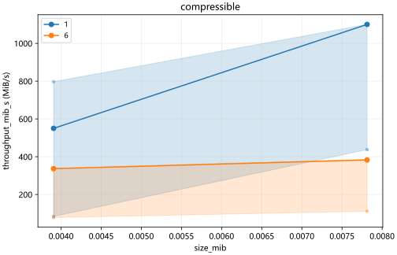
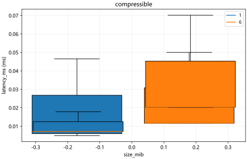
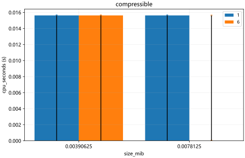
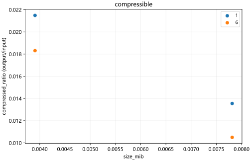
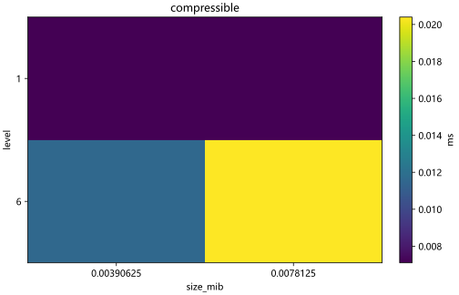
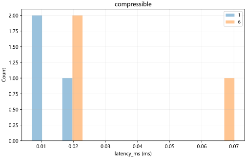
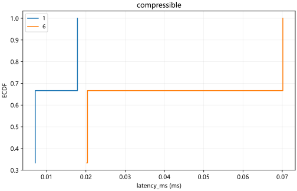
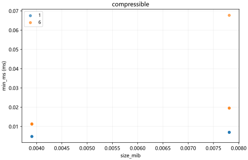
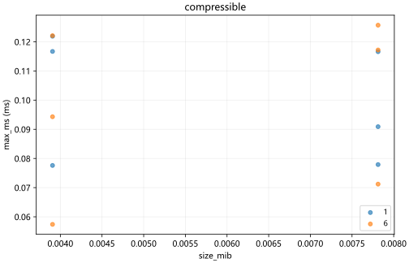

# Performance charts

Charts describe supplied measurements; they do not certify optimization acceptance.

## scatter

Metric: latency_ms; sample level: summary; aggregation: median; range: None. Selected 12 / 12 records.

## line

Metric: throughput_mib_s; sample level: summary; aggregation: median; range: minmax. Selected 12 / 12 records.

## box

Metric: latency_ms; sample level: summary; aggregation: None; range: None. Selected 12 / 12 records.

## bar

Metric: cpu_seconds; sample level: summary; aggregation: median; range: minmax. Selected 12 / 12 records.

## point

Metric: compressed_ratio; sample level: summary; aggregation: median; range: minmax. Selected 12 / 12 records.

## heatmap

Metric: latency_ms; sample level: summary; aggregation: median; range: None. Selected 12 / 12 records.

## hist

Metric: latency_ms; sample level: summary; aggregation: None; range: None. Selected 6 / 12 records.

## ecdf

Metric: latency_ms; sample level: summary; aggregation: None; range: None. Selected 6 / 12 records.

## min_ms

Metric: min_ms; sample level: summary; aggregation: None; range: None. Selected 12 / 12 records.

## max_ms

Metric: max_ms; sample level: summary; aggregation: None; range: None. Selected 12 / 12 records.

