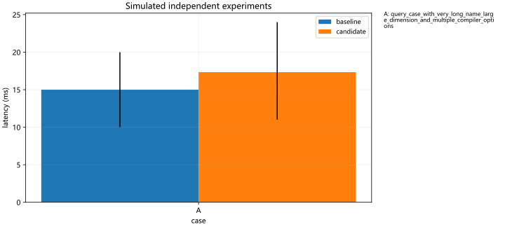

# Performance charts

Charts describe supplied measurements; they do not certify optimization acceptance.

## latency

Metric: latency; sample level: independent_run; aggregation: mean; range: minmax. Selected 6 / 6 records.

- A: query_case_with_very_long_name_large_dimension_and_multiple_compiler_options

Visual review: if the agent cannot read images, user review is required. Rendering success is not visual approval.